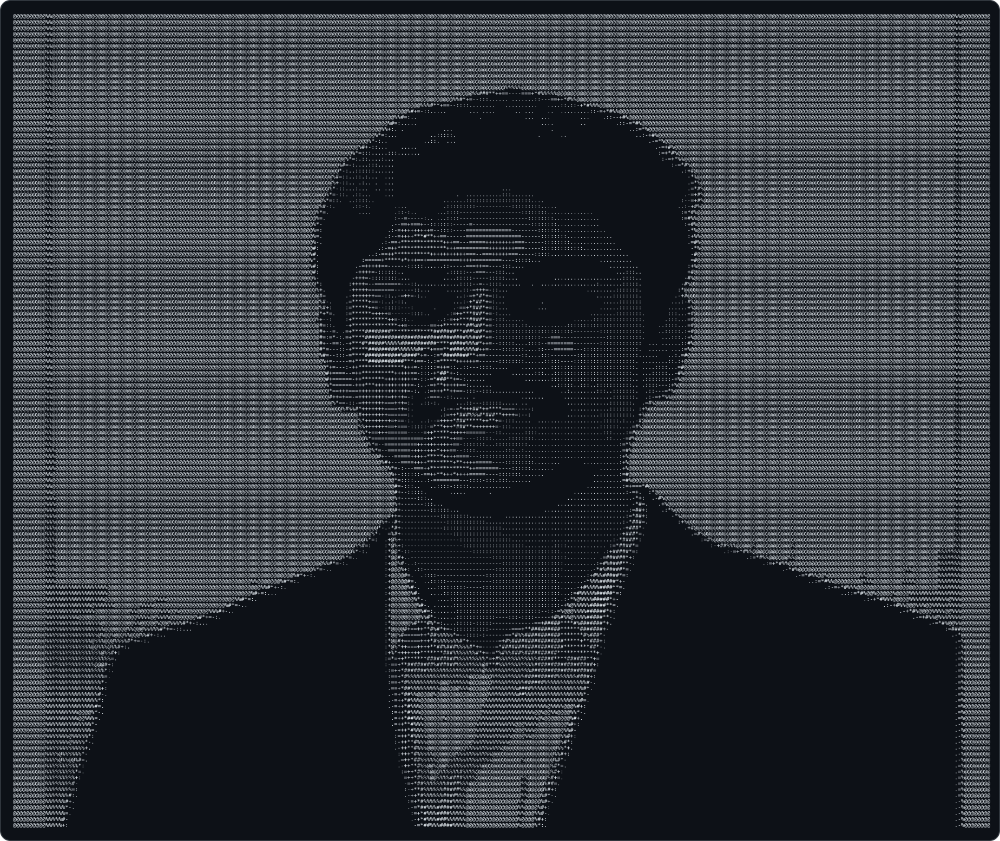

  

 

 

## 🚀 About Me

- 🎓 B.Tech in **Electrical Engineering** at **IIT Indore**
- 💻 Focused on **full-stack web development** and **applied ML**, building tools to solve real-world problems using technology.
- 🧩 Active on [**LeetCode**](https://leetcode.com/u/krish_ji/), [**GeeksforGeeks**](https://www.geeksforgeeks.org/profile/kpji?tab=activity), [**CodeChef**](https://www.codechef.com/users/krizzh), and [**Codeforces**](https://codeforces.com/profile/Krizzh9306), sharpening DSA and problem-solving
- 🛠️ Currently polishing projects and resume for upcoming internship opportunities.

## 🌟 Featured Projects

 

### 📈 [Self-Learning PMS/AIF Statement Parser](https://github.com/Krish-Prasad09/StatementParser)
*Problem Statement of a Fintech Company*

An autonomous financial statement ingestion and multi-custodian portfolio consolidation engine for **SEBI-registered PMS and AIF funds**. Solves the multi-format wealth data fragmentation problem by combining **one-shot LLM template synthesis** with **sub-50ms deterministic Python execution**, eliminating ongoing AI token costs and hallucination risks.

**Key Highlights:**
- ⚡ **One-Shot Learning Architecture:** Leverages **Gemini API** once on unseen statement layouts to synthesize declarative JSON parsing schemas, executing deterministic **sub-50ms parsing** with **zero AI calls** thereafter across **30+ statement formats** (PDF, multi-sheet Excel, and sectioned CSV).

- 🛡️ **17-Rule Financial Safety Gate:** Enforces double-entry roll-forward reconciliations, row-level arithmetic (`Quantity * Price == Market Value`), and **ISO 6166 Mod-10 Luhn checksum verification** on stock ISINs to strictly fail closed against data corruption.

- 💼 **Multi-Custodian Portfolio Consolidator:** Unifies client wealth across fragmented wealth managers (Kotak, ASK, ICICI) joined by **12-character ISIN** and **PAN**, with absolute **INR/USD currency isolation** and dedicated unlisted AIF alternative buckets.

- 🔄 **Layout Drift Interception:** Automatically flags modified table geometries or renamed columns, creates candidate `_v2` schemas with `approved: false`, and locks statements in a **Quarantine Review Queue** awaiting one-click human auditor sign-off.

- 📬 **Automated Mailbox Ingestion & Security:** Integrates an **IMAP SSL** email poller with `BODY.PEEK` idempotency to pre-classify statements from factsheets/invoices, featuring ephemeral in-memory decryption for password-locked PDFs and **Neon Cloud PostgreSQL** persistence.

`Python 3.11` `Gemini API` `Streamlit` `Neon PostgreSQL` `Pydantic v2` `pdfplumber` `openpyxl` `IMAP SSL` `Pandas` `Docker`
🔗[Video Demo](https://drive.google.com/file/d/1iaSl2R2ejnGPGycQRoGFrllXRsy7RDth/view?usp=drive_link).

 

 

### 🎤 [EmoSense — AI Interview Analyser & Multimodal Speech Coach](https://github.com/Krish-Prasad09/EmoSense-Interview-Analyser)
*Machine Learning in Signal Processing Course Project · Under Dr. Vivek Kanhagad, IIT Indore (Feb–Apr 2026)*

An AI-powered interview communication and vocal delivery coach that evaluates **how** a candidate speaks, not just what they say. Ingests microphone audio or uploaded files, performing dual-stream acoustic and linguistic evaluation with zero database overhead.

**Key Highlights:**
- 🎯 **Acoustic Emotion Recognition (Wav2Vec2):** Fine-tuned `facebook/wav2vec2-base` on the **CREMA-D dataset** (7,442 clips, 91 actors) across 6 emotion classes, achieving **80% test accuracy** — nearly doubling the **43% baseline** of traditional LSTM models.

- 🧠 **Multimodal Late-Fusion Architecture:** Ensembles acoustic prosody from **Wav2Vec2** with semantic sentiment from **DistilRoBERTa** on the transcribed text, eliminating false vocal tone classifications through dual-modality probability averaging.

- ⏱️ **Active-Speaking Pace & Linguistic Engine:** Leverages **OpenAI Whisper** chunk timestamps to compute delivery pace (WPM) strictly across active speech segments (excluding silences & interviewer turns), paired with multi-pass filler word detection, spoken grammar validation, and length-normalized CTTR vocabulary scoring.

- 📊 **Temporal Emotion Timeline & Canvas Visualizer:** Generates an emotion evolution timeline using a 4-second sliding window sampled every 10 seconds, rendered dynamically via an interactive, zero-dependency **HTML5 Canvas** stacked-bar visualizer.

- 🛠️ **In-Memory Audio Transcoding & Cloud Deployment:** Built a resilient **FFmpeg + Torchaudio** bridge resolving browser WebM/Opus codec limitations to 16 kHz Mono PCM WAV; containerized with **Docker** and deployed on **Hugging Face Spaces** with weights hosted on the **Hugging Face Hub**.

`Python 3.10` `Flask` `PyTorch` `Torchaudio` `Wav2Vec2` `OpenAI Whisper` `DistilRoBERTa` `Transformers` `Docker` `FFmpeg` `HTML5 Canvas`  
🔗 [Live Demo](https://huggingface.co/spaces/Krizzh/EmoSense-Interview-Analyser) 

 

 

### 🎓 [RankUp — Smart AI Learning Assistant & Multiplayer Study Arena](https://rank-up-learning-assistant.vercel.app/)

A full-stack **MERN** academic platform that transforms dense study notes into interactive learning tools and real-time multiplayer battles. Features in-memory streaming text parsing that supports **150+ page PDFs** with zero database bloat (>95% storage reduction).

**Key Highlights:**
- ⚡ **High-Capacity AI Study Tools:** Generates structured summaries, active-recall flashcard decks, and contextual Q&A chat (supporting document-only vs. web-grounded modes).

- 🎮 **Live Multiplayer Quiz Arena:** Built with **Socket.io** for real-time competitive study battles featuring server-authoritative countdowns, instant host controls, and live dynamic leaderboards.

- 📂 **Cross-Folder Quiz Engine:** Synthesizes custom exams across multiple document folders, paired with an AI diagnostic engine that analyzes concept gaps from incorrect answers.

- 🖨️ **Vector PDF Exports & 3D WebGL:** Generates downloadable, print-ready study sheets with **PDFKit** and features interactive **Three.js** 3D planet visualizations.

- 📅 **Gamified Productivity:** Color-coded study task calendar, daily learning streak tracking, and secure **Google OAuth 2.0 + JWT** sessions.

`React` `Vite` `Tailwind CSS` `Node.js` `Express` `MongoDB Atlas` `Socket.io` `Three.js` `Groq API` `PDFKit` `Google OAuth 2.0` `JWT`
🔗 [Live Demo](https://rank-up-learning-assistant.vercel.app/) 

 

 

### 🤖 [HireU — Career Assistant](https://github.com/Krish-Prasad09/HireU-CareerAssistant)
A full-stack AI career platform with a TypeScript + React.js frontend and Node.js/Express.js backend, supporting resume analysis, job-role matching, and AI-generated interview question sets. Uses the Gemini API with role-aware prompt templates for personalised career insights, ATS-optimised resume suggestions, and an **IIT-style** LaTeX resume builder. Implements Google OAuth 2.0 + JWT session management with role-based access, with Razorpay wired in for premium subscriptions. Frontend deployed on Vercel, backend on Render.

`React 19` `TypeScript` `Vite` `Tailwind CSS v4` `Node.js` `Express 5` `MongoDB Atlas` `Google OAuth 2.0` `JWT` `Gemini API` `Razorpay` · 🔗 [Live App](https://hire-u-career-assistant.vercel.app)

 

## 🧩 Other Projects

| Project | Description | Stack |
|---|---|---|
| [IITISOC-AmpaNova](https://github.com/Krish-Prasad09/IITISOC-AmpaNova) | Mixed-signal function generator & analog signal-processing system — filtering, modulation, differential equation solver circuits, and ADC↔DAC interfacing, simulated in LTspice | `LTspice` `Analog Circuit Design` |
| [JavaScript-Practice-Projects](https://github.com/Krish-Prasad09/JavaScript-Practice-Projects) | Tic-Tac-Toe, Rock-Paper-Scissors, and a live-rate Currency Converter, each deployed on Netlify | `HTML` `CSS` `JavaScript` |
| [Frontend-Practice-Projects](https://github.com/Krish-Prasad09/Frontend-Practice-Projects) | Weather App, To-Do List, Quiz App, Quote Generator, Notes App, and Age Calculator, each deployed on Netlify | `HTML` `CSS` `JavaScript` |

## 🧠 DSA Stats

## 🛠️ Tech Stack

**Languages**

**Frontend & UI**

**Backend & Databases**

**AI, Data Science & Machine Learning**

**DevOps & Tools**

 

📫 Reach me on [LinkedIn](https://www.linkedin.com/in/krish-prasad-29469633b/)

